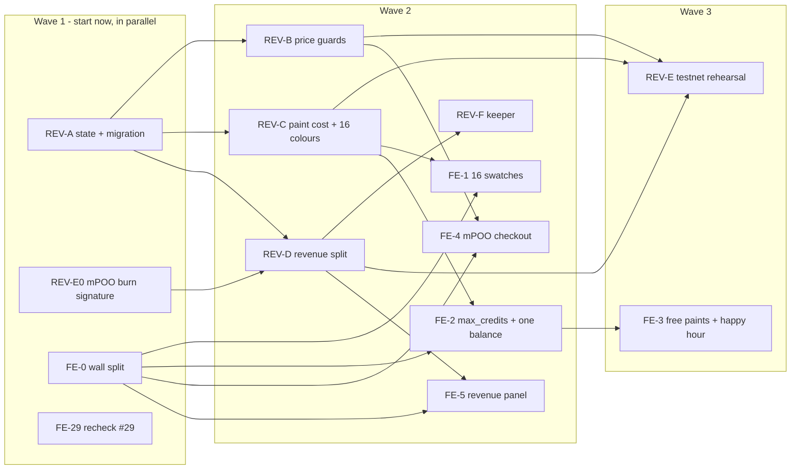

# Work queue — 1 November 2026

**Baseline:** `main` = `0c3eb8d`. **Goal:** the launch contract and the page that goes with it, built in
parallel by several agents without colliding.

Specs: [paid board revision](../payments/2026-11-01-paid-board-revision-spec.md) ·
[wall controller split](2026-11-01-wall-split-spec.md). Every row below has a work order (`*.task.json`
in this folder) that an agent can be given as-is. TOILET is the next review round and isn't here.

Assignees are suggestions by lane (Codex: contracts, Cursor: frontend, Hermes: chain and ops, Claude:
anything, priority over Codex). The owner or Hermes reassigns freely.

## Waves

## Assignment

| id | work order | lane | blocked by | files it owns |
|---|---|---|---|---|
| **REV-A** | [`rev-state-migration`](rev-state-migration.task.json) | Codex | — | paid-board structs, `migrate.rs`, `upgrade` |
| **REV-E0** | [`mpoo-burn-signature`](mpoo-burn-signature.task.json) | Hermes | — | docs only |
| **FE-0** | [`wall-split`](wall-split.task.json) | Cursor or Claude | — | `web/src/pages/wall/**` |
| **FE-29** | [`issue-29-recheck`](issue-29-recheck.task.json) | Hermes or owner | — | none (browser check) |
| **REV-B** | [`rev-price-guards`](rev-price-guards.task.json) | Codex | REV-A | `payments.rs` pricing, `Tunables::validate` |
| **REV-C** | [`rev-paint-cost`](rev-paint-cost.task.json) | Codex | REV-A | `draw`, `draw_many`, `PALETTE`, `free_paint.rs`, `shared/palette.ts` |
| **REV-D** | [`rev-revenue`](rev-revenue.task.json) | Codex or Claude | REV-A, REV-E0 | `revenue.rs`, `safety.rs`, `ft_on_transfer` parsing |
| **REV-F** | [`revenue-keeper`](revenue-keeper.task.json) | Hermes | REV-D (interface) | `ops/keeper/` |
| **FE-1** | [`fe-palette-16`](fe-palette-16.task.json) | Cursor | FE-0, REV-C | `wall-view.ts` palette, CSS |
| **FE-2** | [`fe-max-credits`](fe-max-credits.task.json) | Cursor | FE-0, REV-C | `pricing-controller.ts`, `paint-controller.ts` |
| **FE-4** | [`fe-mpoo-checkout`](fe-mpoo-checkout.task.json) | Cursor | FE-0, REV-B | buy-credits sheet, `paint-wallet.ts` |
| **FE-5** | [`fe-revenue-panel`](fe-revenue-panel.task.json) | Cursor | FE-0, REV-D | new revenue panel |
| **REV-E** | [`rev-testnet-rehearsal`](rev-testnet-rehearsal.task.json) | Hermes | REV-B, REV-C, REV-D | deployment record, cost doc, `STORAGE_PER_PIXEL` |
| **FE-3** | [`fe-free-paints-happy-hour`](fe-free-paints-happy-hour.task.json) | Cursor | FE-2, REV-C | pricing display, happy-hour banner |

Up to **four agents in wave 1** and **eight in wave 2**. The frontend tasks can start against the
spec'd contract interface with fake services as soon as FE-0 merges. Only their testnet check waits for
REV-E.

## Rules that keep parallel work from colliding

1. **One owner per file set**, as in the table. If a task needs a file another open task owns, it
   waits or the two agree in their PRs which lands first.
2. **REV-A lands every new struct field.** REV-B, REV-C and REV-D add behaviour, not layout. If one of
   them finds a missing field, it's a small follow-up to REV-A's layout, not a private addition.
3. **`ft_on_transfer`:** REV-D owns message parsing; REV-B adds the cap check inside the credit path.
4. **`mount-wall.ts` is frozen** for everyone except FE-0 while FE-0 is open.
5. **Each PR updates `docs/backlog.md`** for its own row, with the merge commit (`AGENT.md`).
6. **Nothing deploys to mainnet** from this queue. REV-E upgrades `board3.metapoo-player1.testnet` only.

## Waiting on the owner

- The **team and buyback account ids** for testnet. REV-E needs them. REV-A and REV-D take them as
  arguments and don't block on them.
- The **mPOO daily cap** launch value (recommended 20,000 credits a day). It's a setting, so nothing
  blocks on it.
